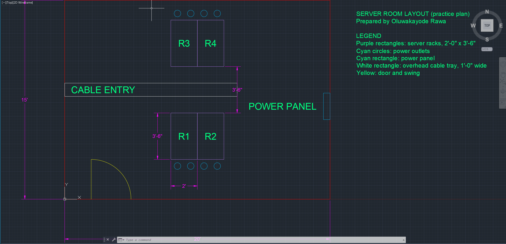

# Server Room Layout in AutoCAD

A 2D floor plan of a small server room, drawn in AutoCAD 2023. This is a practice project. The room and rack sizes are assumed, not taken from a real client site.

## What the plan shows

- A 20 ft by 15 ft room with one 3 ft door and its swing
- Four server racks (R1 to R4), each 2 ft wide by 3 ft 6 in deep, in two rows of two
- A 3 ft 6 in aisle between the rows
- A 1 ft wide overhead cable tray running from the cable entry on the left wall down the middle of the aisle
- A power panel on the right wall and eight power outlets, two behind each rack
- Dimensions for the room, a rack, and the aisle, plus a title and legend

## Files

| File | What it is |
|---|---|
| `Server_room_layout.dwg` | The AutoCAD drawing (open it in AutoCAD or the free Autodesk Viewer) |
| `Server_room_layout-Model.pdf` | A black and white printout, Letter size, landscape |
| `screenshot.png` | A screenshot of the drawing |

## How it is built

- **Layers:** seven layers (WALLS, DOORS, RACKS, CABLE-TRAY, POWER, DIMENSION, TEXT). A layer is like a transparent sheet, so each kind of object can be hidden or recolored on its own.
- **Exact placement:** the room, racks, tray, and panel were drawn by typing coordinates, so every size and position is exact.
- **Block:** one rack was saved as a block named RACK, then copied to the other three positions. A block is a drawing saved as one reusable object.
- **Dimensions:** added with linear dimensions and set to show feet and inches.
- **Text:** rack labels and a multi-line title and legend.
- **Output:** printed to PDF at Letter landscape, fit to the page, in black and white.

## Assumptions and limits

- All sizes and positions are assumed for practice.
- Space behind the racks is uneven: the bottom row has 3 ft behind it, but the top row has only 1 ft 6 in. A real room would need a consistent working space, based on the equipment maker's requirements and local codes.
- Not included: cooling, fire protection, floor loading, a raised floor, and cable paths to each rack.
- The tray is a single straight run. Outlet positions are illustrative.
- This plan was not reviewed by an engineer and is not for construction.

## Problems I hit and how I fixed them

1. **The drawing zoomed out to almost nothing.** A distance check read about 3.7E+27 and Zoom Extents zoomed far out, because early test objects with huge coordinates were still in the file. My erase command had not been confirmed with Enter, so those objects stayed. I confirmed the selection, then redrew everything from exact coordinates.
2. **One rack copy landed outside the room, and my first fix moved two other racks 15 ft.** My selection caught more racks than I meant to move. I selected the racks by clicking each one and moved them back using exact coordinates.
3. **Dimensions showed long decimals like 240.0000.** I changed the dimension unit format to Architectural so they read 20'-0" and 3'-6".

## What I would add next

- Cooling and the cable path to each rack
- A second, angled tray run
- A check of the layout against a published standard, after I have read it

## Tools

AutoCAD 2023
